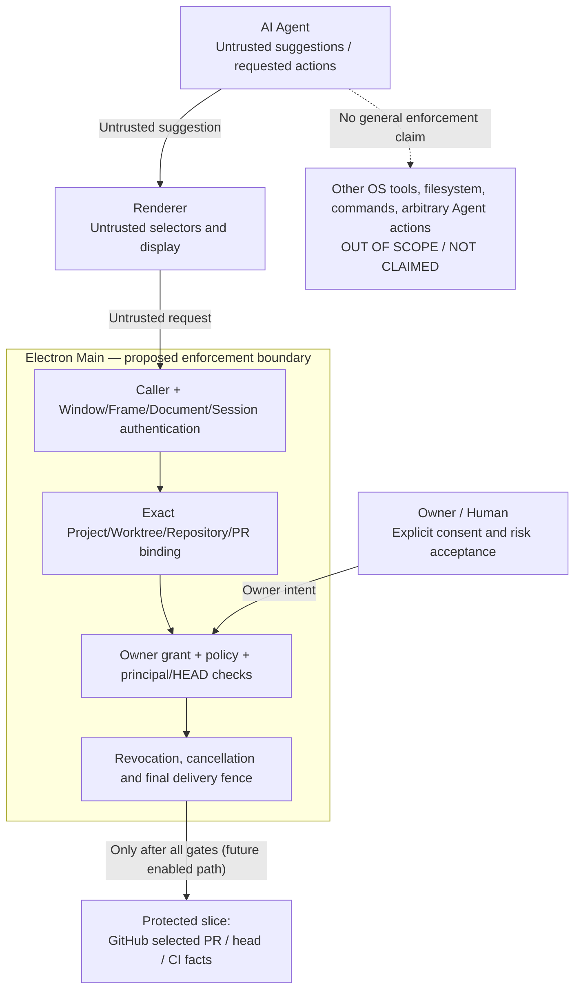

# ADR-001: Bounded Agent-Initiated Permission Containment for GitHub Selected-PR Facts

- **Date:** 2026-10-25
- **Status:** Proposed — L2 architecture decision documented; L3 production security **BLOCKED**
- **Scope:** Packaged, native **Personal** DevCrew; one Owner-selected Project / registered repository / selected GitHub PR; manual, read-only factual retrieval
- **Decision owner:** Repository owner (solo-maintainer model)
- **Implementation baseline:** `company-work@01ee74928a24a14d787ed65ed191134bddc7f368` (merged G1 only)
- **Unmerged evidence:** Draft [#166](https://github.com/Guan21/cc-orca/pull/166), [#170](https://github.com/Guan21/cc-orca/pull/170), [#175](https://github.com/Guan21/cc-orca/pull/175) and [#177](https://github.com/Guan21/cc-orca/pull/177); their CI and offline tests do not imply inclusion on `company-work`

> **Evidence/claim boundary:** This ADR documents a scoped design and a set of implemented **offline** guards on unmerged development branches. No complete production lifecycle domain is VERIFIED. The protected Source/Renderer integration and live GitHub access remain disabled. Do **not** interpret this document as proof that DevCrew contains arbitrary Agent tool calls, native commands or file-system access.

## 1. Context and problem

AI-assisted desktop engineering workflows combine untrusted renderer content, potentially agent-originated actions, the user's effective GitHub identity, asynchronous operations, and a long-lived Electron Main process. If selectors supplied by a Renderer or Agent are treated as authority, a stale project binding, changed PR head, swapped document/session, or revoked permission may expose out-of-scope data. A successful API request does not prove authorized delivery.

The initial protectable slice is GitHub-observed PR/head/check *facts* for a single explicitly selected Project. The read model (G1) is pure and bounded; its existence does not authorize an API read, create a task-completion fact, or establish Agent authorship. Review Intelligence and broader Engineering Control Plane goals are not part of this authorization decision.

## 2. Decision and trust boundaries

**Decision:** Treat Renderer and Agent-originated requests as untrusted intent. Keep authorization state and enforcement in Electron Main. Permit an operation only when Main can establish a verified caller/active frame/document/session, explicit Owner consent, exact Project/worktree/repository/selected-PR binding, current credential principal/policy/grant/HEAD evidence, and a current operation incarnation. Re-check authority across asynchronous and callback boundaries, including immediately before protected delivery. On unknown/missing/stale evidence, deny without using a broader fallback.

**Boundary interpretation:**
- **Owner** controls consent, pilot scope and residual risk acceptance; selection alone never mints a grant.
- **Renderer** cannot authenticate itself with a Project ID, PR number, name, or supplied session token; result display is also a protected delivery step.
- **Agent** may propose a selection/action, but this ADR creates no independent Agent authorization, tool-execution sandbox or generic execution mediation.
- **Main** owns authority records, binding/grant revisions, lifecycle retirement and delivery checks; external GitHub fact access is a *future integration* behind these gates.
- **GitHub, credential storage and native OS** are outside Main's trust boundary; their effective identity/ACL and safe transport must be proved, not assumed from local state.

## 3. Four security invariants

| ID | Invariant | Required enforcement and proof boundary |
| --- | --- | --- |
| **INV-01 — No self-authorization** | Renderer/Agent-provided identifiers or UI selection cannot mint authority. Main verifies caller and obtains an explicit, currently valid Owner grant. Offline grant/IPC contracts exist; complete native consent, caller and policy composition is not production-proven. |
| **INV-02 — Exact current scope** | Every access ties an active caller and incarnation to immutable Project/Host/Worktree, authenticated repository identity, selected PR, and allowed HEAD/check scope, plus monotonically retired binding/grant epochs. String names/path selectors are not proof. Real trusted registration, principal and HEAD publishers remain unresolved. |
| **INV-03 — Revocation before delivery** | On any observed relevant authority change, retire dependent grants and receipts, reject reentrant mutations, cancel outstanding work, and reject stale responses *including after callbacks* and at final delivery. Covered Main Store, picker, grant and bootstrap paths have bounded offline evidence; unobserved and native production lifecycle changes remain unproven. |
| **INV-04 — Fail closed on unknown** | Missing consent, unknown ACL/check visibility, unsupported runtime/profile, absent principal/HEAD, inconsistent or late facts, interrupted fetch, and missing trustworthy producer return unavailable/denied; no fallback to unscoped CLI, WSL, SSH, local Git HEAD, or cached Renderer authority. Source and Renderer remain disabled. |

**Threats addressed by the decision (within the stated slice):** confused-deputy reads from untrusted UI selectors; A→B→A authority resurrection; time-of-check/time-of-use races; callback/reentrant state replacement; stale data delivery after lifecycle changes; false confidence from incomplete permissions or HEAD provenance.

**Threats not covered:** arbitrary Agent shell/file/tool calls; malware/process isolation; full credential custody or OS sandboxing; complete GitHub account or Checks API authorization; unobserved remote credential changes; broad team/Corporate multi-user tenancy.

## 4. Representative verification scenarios

The table separates testable security intent and bounded observed evidence from still-missing native or real-source proof. **Offline PASS is never a substitute for a real installed application or live GitHub E2E.**

| Scenario | Expected result | Evidence | Residual requirement |
| --- | --- | --- | --- |
| **V01: Renderer forges Project/repository/PR selection** | Reject mismatched caller, binding and grant; never trust client-provided IDs | G2 design and Main/IPC/grant negative-test work in Draft stack | Independently trusted Repo Node ID registration and native caller/ACL proof |
| **V02: Project A→B→A during selection** | Old epochs/grants/receipts remain invalid even when visible identifiers revert | B5e Store/picker publication and grant ABA regressions in [#175](https://github.com/Guan21/cc-orca/pull/175) | Audit all alternate Store writers and installed Project switch |
| **V03: Pending asynchronous read, then grant revoked** | Abort and suppress late result; do not deliver protected facts | Grant final-callback and stale async tests in #175 and earlier fence [#166](https://github.com/Guan21/cc-orca/pull/166) | Approved production fact sender, presentation fence, live negative E2E |
| **V04: Callback reentry / nested retirement** | Retire authority before invoking callbacks; block reentrant publication and partial state | B5e before-publication tests (#175); B5f principal/HEAD callback regressions ([#177](https://github.com/Guan21/cc-orca/pull/177)) | Complete callback/producer coverage in native runtime |
| **V05: Document, Window or Electron Session replaced while work is pending** | New incarnation must not inherit previous grant or display old result | B5f Main window pre-factory retirement and Session ABA offline tests (#177) | Native Windows/macOS replacement ordering, lost-event cases and restart QA |
| **V06: GitHub principal, credential generation or selected-PR HEAD changes** | Retire receipts; reject stale principal/HEAD and unknown effective ACL | B5f deny-only contract and offline HEAD/principal tests (#177) | **BLOCKED:** real authenticated principal/generation, HEAD producer and GitHub Repo/Checks permission proof |

For reproducibility, record each evidence run's exact commit SHA, suite, environment, negative input, expected/observed outcome, and whether the source is a fixture or installed native observation. Treat skipped CI jobs and unexecuted E2E as SKIPPED / NOT EXERCISED, never PASS.

## 5. Implementation and provenance evidence

| Layer / milestone | Evidence level | Recorded observation |
| --- | --- | --- |
| G1 bounded Project-facts read model | **Merged baseline (inert)** | [PR #149](https://github.com/Guan21/cc-orca/pull/149) on `company-work`; no live reader or grant |
| Final delivery and async operation fencing | **Draft / offline** | [PR #166](https://github.com/Guan21/cc-orca/pull/166); does not enable live source |
| Main authority composition and lifecycle revocation | **Draft / offline** | [PR #170](https://github.com/Guan21/cc-orca/pull/170); native completeness unproved |
| B5e before-publication retirement | **Draft / offline** | [PR #175](https://github.com/Guan21/cc-orca/pull/175), head `48b97dd465b22e999d3bf7b2fc9a2306dcbed13c`; **33 files / 743 tests PASS**, CI passed at that SHA; 13-domain result: no complete VERIFIED |
| B5f Session / Principal / HEAD deny-only retirement | **Draft / offline** | [PR #177](https://github.com/Guan21/cc-orca/pull/177), head `23e7594f6377baacde6ec28411295b77604181c9`; **37 files / 778 tests PASS**, CI passed at that SHA; Session PARTIAL, Principal BLOCKED, HEAD BLOCKED |

These test totals belong to their respective runs; they are **not additive**. The #177 run and CI were performed on its stacked Draft branch, not on `company-work`. Local typecheck OOM noted in #177 is not reclassified as local PASS by successful CI. See [B5e matrix at pinned SHA](https://github.com/Guan21/cc-orca/blob/48b97dd465b22e999d3bf7b2fc9a2306dcbed13c/docs/reference/github-project-source-g2-b5e.md) and [B5f report at pinned SHA](https://github.com/Guan21/cc-orca/blob/23e7594f6377baacde6ec28411295b77604181c9/docs/reference/github-project-source-g2-b5f.md) for producer ownership and precise coverage.

**13 lifecycle domains (B5f state):**
- **PARTIAL:** Project, Worktree, Repository, selectedPr, Window, Frame, Document, Session, Credential, Grant, Policy.
- **BLOCKED:** Principal, HEAD.
- **VERIFIED:** None. Production composition advertises an empty/unavailable lifecycle map.

## 6. Alternatives and trade-offs

| Alternative | Decision and reason | Cost / limitation of chosen approach |
| --- | --- | --- |
| Trust Renderer selectors or UI-selected PR | **Rejected** — selectors are intent, not authenticated caller/scope or consent | Additional Main-bound state, explicit UX consent and IPC validation |
| Check only when a request begins | **Rejected** — async, callbacks and document/HEAD changes can invalidate the original authorization | Epochs, cancellation, synchronous retirement and final delivery fences increase lifecycle complexity |
| Reuse generic `gh` transport / local Git HEAD as authoritative fallback | **Rejected** — environment/host/principal may change and local HEAD is not authenticated selected-PR HEAD | A source can be unavailable until pinned native transport, effective ACL and HEAD evidence exist |
| Allow access on missing producer or incomplete Checks data | **Rejected** — unknown cannot be safely promoted to authorized or complete | Conservative deny-only behavior; lower availability and more native verification effort |
| Build a generic Agent sandbox as part of this ADR | **Deferred / out of scope** — current evidence is limited to selected-PR fact access | A separate threat model and control plane needed for tools, commands, files and arbitrary Agent execution |

## 7. Acceptance and remaining risks

This ADR's **L2 objective** is to present a concrete security decision, its trust boundaries, testable invariants, scoped evidence and residual risks. Its presence or review **does not authorize source activation**.

**L3 production security is BLOCKED** until all applicable controls are demonstrated on an exact code/build SHA: complete Store/native Window/Frame/Document/Session producers and before-publication ordering; trusted repository registration and effective GitHub Repo/Checks ACL; verified credential custody, principal generation and authenticated selected-PR HEAD; complete grant expiry/policy publishers; synchronous protected delivery and display fences; authorized real-source E2E and restart QA on relevant installed platforms.

**Governance:** [Issue #151](https://github.com/Guan21/cc-orca/issues/151) remains open for actual Owner self-review, precise allowed pilot scope, security readiness and risk acceptance. The documented solo-maintainer exception waives scheduling an independent signer for early Personal development only; it does **not** fabricate independent approval or grant Corporate/team release. [Issue #153](https://github.com/Guan21/cc-orca/issues/153) is NOT EXERCISED; V1 [#148](https://github.com/Guan21/cc-orca/issues/148) remains NO-GO. This ADR contains no tokens, private hostnames, selected user data, or live credential evidence.

## 8. Decision consequences and update policy

**Positive:** A defensible, auditable design for a small sensitive data plane, with negative tests focused on stale authority, race conditions and fail-closed behavior. **Negative:** More state/versioning and less source availability; test count does not reduce the need for actual production identity/ACL and native ordering proof.

Update this same ADR with new evidence rows when #151, #153 and producer work advances. Do not rewrite earlier historical claims into PASS; append exact-SHA verification, observed outcomes and revised decision status. A broad, generic Agent permission-containment ADR requires a **separate decision** with a wider threat model, not an inferred promotion from GitHub Selected-PR Source.
