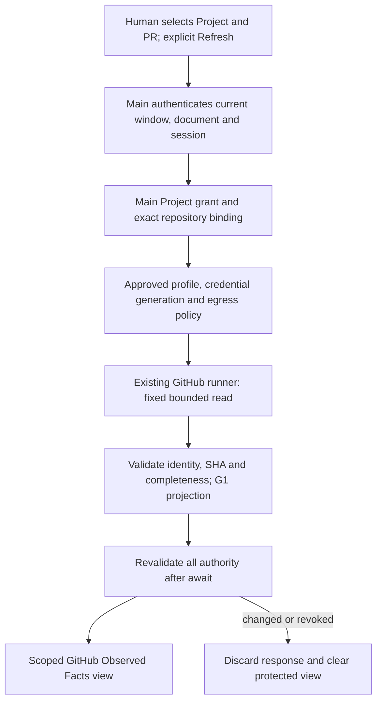

# #116 G2-A — GitHub Project facts source authorization ADR

Date: 2026-10-18. Status: **PROPOSED / BLOCKED on named independent approval**.
This document grants no runtime capability. G2-B and real-source E2E have not started.

## Baseline and decision evidence

- Fetched `origin/company-work` and independently read the GitHub branch tip:
  `01ee74928a24a14d787ed65ed191134bddc7f368`, also the audited local HEAD.
- [G1 PR #149](https://github.com/Guan21/cc-orca/pull/149) merged at that commit.
  Its single-maintainer exception covers inert G1 only, not source/security approval.
- [Owner direction, #116](https://github.com/Guan21/cc-orca/issues/116#issuecomment-6210652782)
  selects GitHub-observed facts; the [latest G1 record](https://github.com/Guan21/cc-orca/issues/116#issuecomment-6245260263)
  explicitly leaves G2 authority, credentials, egress and real E2E open.
- [#138](https://github.com/Guan21/cc-orca/issues/138#issuecomment-6210653865)
  separates this source from user-declared Run assignment and attested native execution.
  [#148](https://github.com/Guan21/cc-orca/issues/148#issuecomment-6245260912)
  retains V1 NO-GO and the independent security/release gates.
- Open PR inventory was checked on this date. #129/#131/#133/#135/#137 are the
  unmerged native-source stack; #130 is its separate design. #140/#142 concern
  organizational assignment; #144/#146/#147 concern shared context/handoff.
  None establishes an approved G2 GitHub reader. Do not merge/copy those stacks.
  [#130 reviews](https://github.com/Guan21/cc-orca/pull/130)
  must be checked on the PR itself; a COMMENT on native-source design is not G2 approval.

The evidence is a dated observation, not a claim that later approvals cannot exist.
Recheck #116/#138/#148 and this ADR's reviewed revision before implementing.

## Reuse audit at the baseline

Paths below are baseline source references, not proposed new subsystems.

| Concern            | Existing source / mechanism                                                                                                                 | Reuse boundary or missing capability                                                                                                                                                                        |
| ------------------ | ------------------------------------------------------------------------------------------------------------------------------------------- | ----------------------------------------------------------------------------------------------------------------------------------------------------------------------------------------------------------- |
| GitHub API         | `src/main/github/client.ts`; `client/check/get-pr-checks.ts`; `client/fetch/get-work-item.ts`                                               | Existing client family owns GitHub operations. High-level reads enrich/fallback; they do not supply a minimal complete SHA-pinned G2 batch.                                                                 |
| CLI transport      | `src/main/git/command-runner/gh-exec-file.ts`, `gh-host-args.ts`; `src/main/github/gh-utils.ts`                                             | Reuse process capture, deadlines, abort, host pinning, semaphore and rate breaker. Runtime fallback and retry need an explicitly reviewed restriction within this runner.                                   |
| Credentials        | `src/main/github/auth-diagnose.ts`; `client/fetch/authenticated-viewer.ts`                                                                  | Ambient environment/keyring diagnosis and viewer lookup exist. They are not a G2 grant, restricted credential or stable credential-generation authority; do not call viewer lookup merely for this audit.   |
| Repository         | `src/main/github/github-api-repository.ts`; `github-repository-identity.ts`; `github-repository-host.ts`                                    | Host-qualified owner/name, local/WSL/SSH routing and cache partitioning exist. No reviewed Project binding to immutable GitHub numeric AND opaque node IDs is wired.                                        |
| Project catalog    | `src/shared/project-types.ts`; `src/main/persistence/tracking-repos/project-host-operations.ts`                                             | Project/sourceRepoIds and ProjectHostSetup relate Project, local Repo, path and execution host. Catalog presence is not a sensitive-data ACL or monotonic binding authority.                                |
| Workspace          | `src/shared/folder-workspace-types.ts`; `src/shared/execution-host.ts`                                                                      | Retain exact folder/worktree and execution-host distinctions. Paths/display names never authenticate a Project.                                                                                             |
| Current GitHub IPC | `src/preload/api/github-work-item-api.ts`; `src/main/ipc/github-work-item-handlers.ts`; `github-repo-routing.ts`                            | Registered-repo checks accept renderer selectors; no exact G2 document/Project grant. Do not extend this into arbitrary-repository Project reads.                                                           |
| Sender lifecycle   | `src/main/ipc/runtime.ts`; `desktop-runtime-sender-lifecycle.ts`                                                                            | Current main-frame validation and document-generation retirement are foundations, not a G2 window allowlist or sufficient Project ACL/session proof. Navigation/process loss already retires subscriptions. |
| Corporate          | `src/shared/corporate-build-profile.ts`; `src/shared/network/corporate-network-contract.ts`; `docs/reference/corporate-network-contract.md` | Capability/category policy is not an endpoint/method/query allowlist. A user initiator, valid destination or credential alone cannot authorize G2.                                                          |
| Static scanner     | `config/corporate-forbidden-endpoints.json`; `config/scripts/corporate-forbidden-endpoint-scanner.mjs`                                      | Legacy-endpoint regression protection, not proof of runtime egress or positive source authorization.                                                                                                        |
| G1                 | `src/shared/github/project-facts-read-model.ts`, `projectGitHubFacts()`                                                                     | Pure bounded validation/projection; no production caller found. Preserve the 100-fact ceiling and strict UTC/freshness/identity rules.                                                                      |
| Project UI         | `src/renderer/src/app-shell/ProjectMapDesktopPage.tsx`; `components/project-map/ProjectMapPage.tsx`                                         | Desktop supplies no snapshot and displays source unavailable. Keep this behavior for the native Task map.                                                                                                   |
| State/graph        | `src/shared/project-state/project-state.ts`; `docs/reference/project-state-engine.md`                                                       | Task-centric state cannot represent GitHub facts by manufacturing Task/Agent nodes. Reuse the shell/navigation, not false lifecycle semantics.                                                              |

## Proposed decision and alternatives

Recommend one manually selected PR in one explicitly bound Project, via a fixed
GraphQL read, with in-memory authorization and snapshots only. This is a useful
PR/head-commit/check observation slice, not a complete repository activity feed.
**Product Owner scope decision (2026-10-18): ACCEPTED** this narrowed first implementation slice in [#151](https://github.com/Guan21/cc-orca/issues/151#issuecomment-6248900847): packaged native Personal Desktop, one explicitly selected same-repository PR, manually invoked bounded GraphQL read, truthful selected-PR GitHub facts UI. This is **product-scope acceptance, not permission** to perform any GitHub network call, enable new Main/IPC capabilities, access credentials or relax Corporate policy. Corporate-as-V1-launch-profile and multi-PR-as-V1 requirements are still separate Owner decisions, not erased by this pilot.

Alternatives rejected for this slice: broad existing PR/check loaders expand
fields, cache and fallback requests; owner/name REST fan-out makes immutable
identity and multi-call races harder to prove. Background synchronization,
webhooks and a durable assignment ledger add unnecessary transport/storage
authority. None is approved by this ADR.



### Authority and identity

Propose one Main-owned session registry as the single writer of bindings/grants.
Do not add it until Main/security approval. No new SQLite schema is proposed.
Existing catalog/host setup supplies candidate scope only. An independently
reviewed native user-confirmation flow must issue the actual read grant and bind
the catalog Project to an operator-approved repository identity. Typing an ID or
selecting an existing catalog row cannot issue that grant.

The exact authority tuple is: profile/installation namespace, Main-session
incarnation, authenticated BrowserWindow/WebContents/main-frame/document/Electron
Session, principal and credential generation, DevCrew Project ID, exact workspace
kind+ID, ProjectHostSetup, native execution host, GitHub web/API host, numeric
repository ID, opaque repository node ID, owner/name, binding revision, grant
revision, selected PR number, expiry and policy revision. Never expose authority
tokens to a generic CLI/RPC caller. Renderer selectors are untrusted requests.

Main issues monotonically increasing safe-integer revisions for every switch,
rebind, revoke, deletion and workspace/host transition, including A→B→A. It must
retain revision history for the session, refuse overflow and never reconstruct
authority from catalog equality, timestamps, names or renderer generations.
Main restart creates a fresh incarnation and discards all grants/bindings/snapshots;
fresh confirmation is required. G1's numeric revision remains unchanged; the
outer Main fence owns incarnation/ACL. No old serialized G1 snapshot is accepted.
Durable bindings would require a separately approved single-writer storage design.

Opaque node identity must come from a reviewed Main-controlled registration
ceremony and authenticated response verification, not decoding/inventing a node
ID from a numeric ID. The fixed query below can verify an operator-approved
candidate, but cannot itself authorize that candidate. Same-name replacements,
transfer/rename, host mismatch and deleted/recreated Projects require reapproval.

Proposed grant lifetime: 15 minutes or document/session lifetime, whichever ends
first. Recheck before each await-sensitive action and before delivery; revoke,
logout/account change, navigation/reload, selection change and policy change
abort pending reads, invalidate caches and clear protected UI immediately.
No stale protected facts remain visible after denial. Out-of-band server token
revocation cannot be detected instantly without polling: enforce local revoke
immediately, invalidate on the next failed read, and bound this residual risk by
grant/freshness expiry. Reviewer must explicitly accept that limitation.

### Profiles, credentials and host boundary

**Currently allowed G2 profiles: none.** Proposed first approval scope: native,
packaged Personal Desktop only, with existing approved host-specific `gh`
credential custody. Corporate, development, web, paired, SSH and WSL remain
disabled pending their separate named policy decisions. #138's Personal dev
assignment decision does not authorize this different source.

Record exact account/installation identity, credential provenance/runtime,
repository selection, expiry and effective permissions in the approval evidence;
never record the token. Proposed minimum is repository metadata, pull-request,
contents and checks read access, with no write permission. Fine-grained token
GraphQL support and each selected field must be verified against the approved
credential type before implementation; REST permission tables alone do not prove
GraphQL access. Existing broad ambient credentials are not a least-privilege grant.
If current credentials cannot meet policy, stop; no login/token acquisition or
new token store is authorized by this proposal.

Native runner missing-command fallback to WSL and WSL fallback to native can
change credential principal. `idempotent:false` only stops transient retries;
it does not stop these fallbacks. Extend the existing runner with reviewed
runtime pinning rather than creating another transport. Sanitize conflicting
ambient host/token overrides under the approved custody policy, without reading
or printing secret values. Apply the overall deadline to semaphore wait as well
as child lifetime. No budget-probe request outside the matrix is permitted.

For SSH/WSL, reject before source/credential initialization; do not answer using
client credentials for a remote context. See `ssh-execution-boundary.md` for the
existing acknowledged `gh` inconsistency. This source makes no process-liveness
claim. Folder workspaces can qualify via an explicit trusted repository binding
without `.git` or a worktree; explicit no-worktree is not an all-worktree grant.
GitLab/other providers retain their existing behavior; show GitHub source
unavailable for unsupported providers. No generic review concept is renamed.
No remote wire changes are proposed; any future remote support must follow
`remote-wire-compatibility.md`, with negotiated capability and unavailable fallback.

## Proposed endpoint, method and data policy

All rows are **unapproved**. No Corporate allowlist is changed. A generic
`decideCorporateNetworkIntent(...)=allow` is insufficient; require a separately
signed exact profile/host/method/fixed-operation/credential/scope policy first.

| Endpoint                         | Method / trigger                                                                       | Credential / minimal data                                                                                                    | Egress and failure                                                                                                                     |
| -------------------------------- | -------------------------------------------------------------------------------------- | ---------------------------------------------------------------------------------------------------------------------------- | -------------------------------------------------------------------------------------------------------------------------------------- |
| `https://api.github.com/graphql` | POST, fixed query below, explicit one-PR Refresh or approved binding verification only | Approved native host/account; registered node ID and positive PR number. Return only listed identity/PR/commit/check fields. | Personal proposal only; Corporate disabled. No redirects, alternate host, fallback endpoint, discovery, auth probe, mutation or retry. |
| GHES                             | None enabled or proposed as a wildcard                                                 | Separate exact web host/API path, trusted TLS, schema version and credential decision required                               | Fail closed; never default to dotcom.                                                                                                  |

One request per action, one in-flight action per binding, 15-second total deadline,
1 MiB captured response limit, no disk/CLI response cache. At most ten suites with
eight runs each: 80 checks + one PR + one head commit = 82 G1 facts. These are
proposed limits for review, not deployed defaults. Do not use `--paginate`.

```graphql
query ProjectFacts($repositoryNodeId: ID!, $prNumber: Int!) {
  node(id: $repositoryNodeId) {
    ... on Repository {
      id
      databaseId
      nameWithOwner
      pullRequest(number: $prNumber) {
        number
        state
        merged
        headRefOid
        updatedAt
        headRepository {
          databaseId
        }
        commits(last: 1) {
          nodes {
            commit {
              oid
              checkSuites(first: 10) {
                pageInfo {
                  hasNextPage
                }
                nodes {
                  commit {
                    oid
                  }
                  repository {
                    databaseId
                  }
                  checkRuns(first: 8) {
                    pageInfo {
                      hasNextPage
                    }
                    nodes {
                      databaseId
                      status
                      conclusion
                      repository {
                        databaseId
                      }
                    }
                  }
                }
              }
            }
          }
        }
      }
    }
  }
}
```

This is a review candidate, not an executed or schema-validated integration.
The intentional `commits(last:1)` selects only the head observation, never claims
full commit history. First slice rejects cross-repository/fork PRs: require head
repository, suite and run repository IDs to equal the registered base repository.
Require commit OID and each suite commit OID to equal PR headRefOid. Missing/null
objects, unsafe IDs, GraphQL errors (including partial data), malformed fields,
contradictions or either checks connection's `hasNextPage=true` reject the whole
batch. Report `incomplete` on capacity exhaustion, never silent truncation or
authorized-empty. A nonexistent/inaccessible PR is unavailable/denied, not empty.
Zero fully readable check runs means no observed checks, never CI success.

Normalize GraphQL enums one-to-one to G1 lowercase, preserve null conclusions and
reject unknown values without success inference. Identical facts deduplicate;
contradictory duplicates fail. Do not reuse display mappers that synthesize
statuses or lose check IDs. Main supplies completion-time fetchedAt; PR updatedAt
stays source metadata. G1 validates the exact trusted scope and strict dates.
For PR state, merged takes precedence only when consistent with source state.
Recheck authority after parsing/projection and immediately before UI delivery.

HTTP 401/403 revokes the current readable result (distinguish rate-limit 403);
404/null does not reveal inaccessible resource existence; 429 or rate-limited
403 displays Rate Limited and a safe retry time. Timeout, offline and server
failure display their typed error and discard the new batch. No automatic retry.
Do not expose raw stderr, API errors or response text to the UI/logs.

GitHub API data is untrusted. Exclude title/body/diff/patch/log/comment/author/email
and prompt content at query time; owner/name are bounded escaped labels. Never
execute API text, markdown HTML, URLs or instructions. Source references derive
from validated host/repo/PR/check IDs; evidence navigation requires a fresh grant
and an approved host, not arbitrary returned URLs.

Official references checked 2026-10-18: [GraphQL calls](https://docs.github.com/en/graphql/guides/forming-calls-with-graphql),
[Checks schema](https://docs.github.com/en/graphql/reference/checks),
[GraphQL reference](https://docs.github.com/en/graphql/reference), and
[REST permissions](https://docs.github.com/en/rest/authentication/permissions-required-for-fine-grained-personal-access-tokens).
These support API design research, not runtime authentication or security approval.

## UI, retention and claim boundaries

Use a separate **GitHub Observed Facts** area in existing Project Intelligence
navigation, using `docs/STYLEGUIDE.md`, canonical tokens and existing primitives.
Show bound repository, selected PR number/state/head SHA, head commit, each
check ID/status/conclusion, fetchedAt and freshness. Label scope as selected PR
and head commit; no repository-wide counts, workflow verdict or native execution.
Keep `attestation: not_verified_by_projection`, `agentExecution: unknown` and
`taskCompletion: unknown`. A transport receipt is not native producer attestation.

States: unavailable (no approved source/binding), loading, authorized empty
(only a genuinely successful approved empty selection result), ready, stale,
denied, error, rate limited, offline and incomplete. The selected-PR query normally
returns PR+commit or fails, so zero checks is a ready result, not empty. Existing
native Project Map remains source unavailable. No demo fallback.

Proposed freshness: five minutes maximum, recomputed on view use and expiry,
within G1's maximum horizon. Loading/error/expiry hide prior fact rows; stale
shows expiry metadata only while the grant remains valid. Denial/revocation
clears even protected labels/references. Generation-fence delivery and rendering
to prevent A→B→A flashes, including pending renders and multiple windows.

No persistent snapshots, exports or source logs. Keep bounded Main memory only;
clear on revoke/expiry/quit and require renewed grants after restart. Diagnostic
logging, if separately approved, contains typed outcome, duration and opaque
operation correlation only, not repo/PR/node IDs, names, SHA, query variables,
credentials, raw errors or API content. No telemetry. Approval audit references
belong in the reviewed ADR/issue, without secrets. Durable grant/repository
retention, WAL/backups and migration would require a different reviewed decision.

## Threat model and verification gates

| Threat                                        | Required control / test                                                                                                           |
| --------------------------------------------- | --------------------------------------------------------------------------------------------------------------------------------- |
| Forged renderer, subframe or stale document   | Exact Main-owned window/frame/document/session/principal grant; deny before any spawn and after each await.                       |
| Same name, different repository/host          | Registered numeric+opaque IDs and exact web/API host; immutable node routing; label/identity agreement.                           |
| Project/host ABA, delete/rebind or restart    | Single-writer revisions and incarnation; abort/discard; no imported/cached snapshots or automatic grant restoration.              |
| Confused credential/runtime                   | Approved account/generation and pinned native transport; no ambient override, WSL/SSH substitution or hidden fallback/probe.      |
| Token revoke or stale UI                      | Immediate local revoke; deny on next failed remote read; short grant/freshness limits and explicit residual remote-revoke window. |
| Mixed SHA, partial query or capacity overflow | PR/commit/suite/run identity checks; complete bounded check connections; all-or-fail; no synthetic success.                       |
| Malicious text or evidence URL                | Minimal fields, bounded primitives, escaped labels, validated derived references and separately authorized navigation.            |
| False Agent/Task provenance                   | G1 unknown labels; independent read surface; no DevelopmentEvent lifecycle production.                                            |

The following are G2 acceptance cases, not claims that fixtures exercised a real
source. Record PASS/FAIL only after execution against the exact candidate SHA.

| Required negative test                   | Current G2 status | Required proof                                                                               |
| ---------------------------------------- | ----------------- | -------------------------------------------------------------------------------------------- |
| 1 Unauthorized repository                | BLOCKED           | No read/spawn without Project and repository grant.                                          |
| 2 Same name / different immutable ID     | BLOCKED           | Trusted binding rejects replacement; G1 comparison alone is insufficient.                    |
| 3 Different GitHub host                  | BLOCKED           | Deny before credentials; ambient GH_HOST cannot redirect.                                    |
| 4 Project A→B→A                          | BLOCKED           | Old revision cannot deliver after the second A selection.                                    |
| 5 Switch during API await                | BLOCKED           | Abort/discard response and pending render; no cross-Project flash.                           |
| 6 Token revoke / 401 / 403               | BLOCKED           | Clear facts, distinguish permission and rate errors, no retries.                             |
| 7 Rate limit / 429                       | BLOCKED           | Typed Rate Limited, bounded manual retry only.                                               |
| 8 Offline / timeout                      | BLOCKED           | Deadline covers wait/child; no fallback, no old rows.                                        |
| 9 Expired snapshot                       | BLOCKED           | View timer/use checks hide facts at expiry.                                                  |
| 10 PR head SHA update                    | BLOCKED           | Reject mixed head/check observations; next refresh replaces the entire batch.                |
| 11 Duplicate / out-of-order facts        | BLOCKED           | Deduplicate exact identities, reject contradictions, discard superseded request generations. |
| 12 Malicious API text / prompt injection | BLOCKED           | Excluded fields never reach prompt, DOM HTML, command or log sinks.                          |
| 13 Failed / pending / unknown checks     | BLOCKED           | Preserve failure/pending/null; unsupported enums fail, never PASS.                           |
| 14 Normal quit/restart                   | NOT EXERCISED     | No restored grant/facts; renewed approval and refresh required; terminals unchanged.         |
| 15 No-source demo isolation              | NOT EXERCISED     | Installed candidate has no demo Task/PR/metrics; #128 remains separate.                      |
| 16 Cross-Project facts/evidence          | BLOCKED           | Separate windows/projects cannot read rows, references or in-flight results.                 |

Also require no startup/focus/idle egress, unsupported profiles denied, folder
scope without Git, pinned-runtime fallback refusal, bounded response/query errors,
overflow at both check connection levels and permission-hidden checks. A zero-check
response is not proof of complete visibility without the approved permission test.
Fixture tests and the existing G1 tests can establish parser behavior only.

After approval, one independently reviewed Draft implementation PR must include
focused unit/IPC integration tests, typecheck, lint/static analysis, format,
Corporate scanner, applicable exact-head CI, and approved real-source E2E.
Record redacted actual repo ID, PR ID, commit SHA, source timestamp and candidate
SHA privately under the approved evidence policy; publish only authorized evidence.
Perform Windows/macOS installed QA on isolated displays/CI when claimed; set
`ORCA_BACKGROUND_LAUNCH=1`, use hidden-renderer CDP, never activate user windows.

## Signatures and stop condition

| Role                                                 | Identity / decision / evidence as of 2026-10-18                                                                                                                           |
| ---------------------------------------------------- | ------------------------------------------------------------------------------------------------------------------------------------------------------------------------- |
| Product Owner                                        | `Guan21`: first-slice Personal/manual single-PR product scope **ACCEPTED 2026-10-18**, [#151 decision](https://github.com/Guan21/cc-orca/issues/151#issuecomment-6248900847). **No security or G2 source activation permission granted**; Corporate V1 profile and repository-wide scope priorities still pending. |
| Independent technical architecture / schema reviewer | NOT DESIGNATED; exact ADR revision, query schema, budgets, identity and semantic decision required.                                                                       |
| Independent Main/IPC security reviewer               | NOT DESIGNATED; principal/confirmation issuer, registry/grant lifecycle, epoch/incarnation, sender/session and runner-runtime restriction approval required.              |
| Network / privacy / security reviewer                | NOT DESIGNATED; exact profile, host/method/query, credential identity/type/permissions, revocation window, retention/logging approval required.                           |
| Native QA owner                                      | NOT DESIGNATED; approved repository and isolated Windows/macOS acceptance plan required before real-source validation.                                                    |

No signature, approval date or reviewed SHA is invented. An AI technical review,
green CI, G1 merge or this document's merge cannot fill these rows. A signer must
identify the exact reviewed ADR revision and permitted implementation scope;
material amendments require renewed approval.

**Stop here:** G2-A documentation is reviewable; activation is BLOCKED. Do not
implement G2-B, production network/IPC/grants/persistence, new deny-only layers,
Corporate policy changes, automatic sync, runtime/router changes or native Run
ownership inference. Do not merge the PR, close #116/#148 or claim V1 release PASS.
Publish the specific missing signatures to #116 and the G1/G2-A/G2-B/G2-E2E split
to #148. Resume only against recorded approval evidence and an approved exact
implementation plan; otherwise retain source unavailable.
