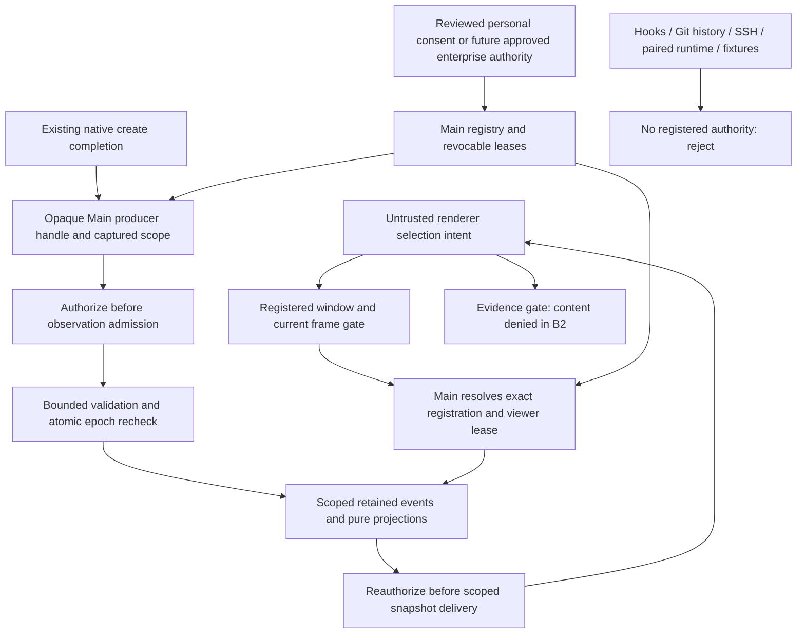
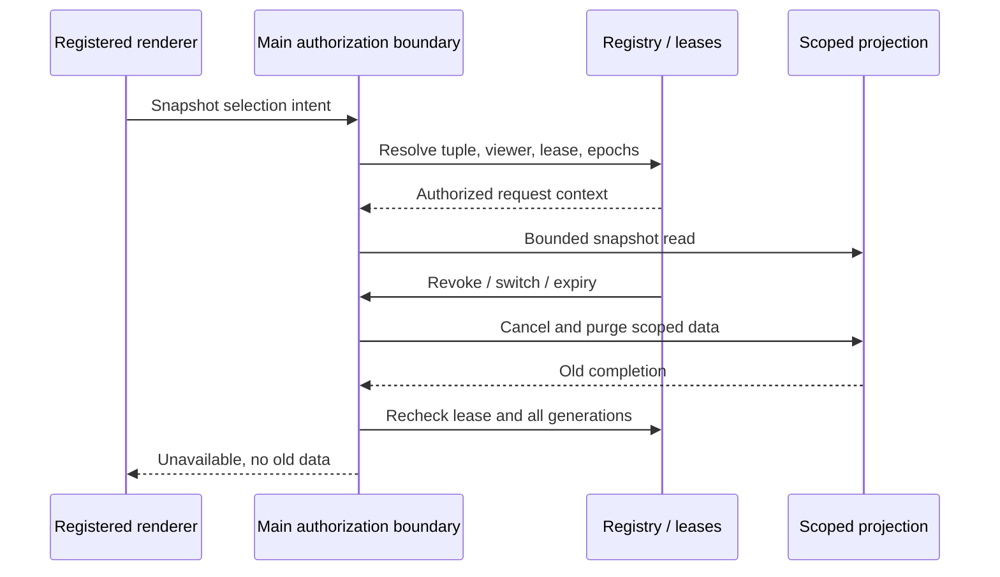

# #116-B1: Trusted local source and Main authorization design

Status: **proposed; first source NOT APPROVED; no production adapter enabled**.
Parent: [#116](https://github.com/Guan21/cc-orca/issues/116). Reconciled contract prerequisite: [Draft PR #129](https://github.com/Guan21/cc-orca/pull/129), at `00a710c278deb642f7af88569200784d312a6c4e` (52 focused contract tests; [final-head CI](https://github.com/Guan21/cc-orca/actions/runs/38549491438) passed typecheck, static analysis and eight unit-test shards). Repository evidence below is from `company-work` at `879ffe46dca1d41c4bfb1e7c6640b2f4c6857516` (2026-10-14). #129 is separate and unmerged; its pure helpers are not present on this base. Passing fixture tests neither approves a producer nor supplies an authorization authority.

## Decision and scope

The strongest narrowly verifiable candidate inspected is **Main's native-local exclusive file-create completion**, specifically `RuntimeFileCommandsWithWriteFileExplorerFile.createFileExplorerFile`. Main resolves the target, authorizes the filesystem path, and awaits `writeFile(..., { flag: 'wx' })`. Today it returns only `{ ok: true }`, with no project-source receipt. Main can observe that its exclusive create call completed; **exact project/root/realm attestation still requires the prerequisites below**. It cannot attest a developer's identity, code correctness, continuing file existence, or all changes in the workspace.

**NOT APPROVED for DevelopmentEvent ingestion.** No existing production DevelopmentEvent producer, approved source registration, project-data grant issuer, or authenticated project-data principal was found. A verifiable operation is a prerequisite, not approval. Missing prerequisites are listed below; no adapter is implemented or activated by B1. A later approved observer could represent that narrow fact as `file.changed` / `added`, using a Main-minted system actor. Do not infer other event types or use write success to claim a task or test completed.

B2 may begin **deny-only infrastructure and adversarial tests** within these proposed boundaries. Enabling even the personal producer requires explicit design/authority review, a verifiable mapping, and the acceptance suite. Corporate activation remains blocked until an approved enterprise policy authority exists. B2 is not permission for new IPC exposure: the channel inventory and security review below must precede any production bridge.

This PR contains documentation only. It adds no network source, telemetry, Git polling, credential storage, runtime wire change, Corporate exception, or UI data. It does not merge #129, alter #128, close #116/#51/#52, or complete Phase 2.

## Source inventory and limits of evidence

| Existing surface | What is actually verifiable | DevelopmentEvent decision |
| --- | --- | --- |
| [DevelopmentEvent v1](../../src/shared/development-event-types.ts), [schema/replay](../../src/shared/development-event-schema.ts), [in-memory bus](../../src/shared/development-event-bus.ts) | Strict shape validation; replay retains input order; `emit` synchronously calls subscribers. Production search found no Main producer using this bus. | NOT APPROVED. Anyone holding `emit` can supply valid labels. No authentication, retention limits, dedupe, or grant checking. Recursive metadata and replay arrays are unbounded. |
| Demo events in Project Pulse/Review and [fixtures](../../src/shared/development-event-fixtures.ts) | Test construction only. | Never production evidence. Reducers/selectors do not turn fixtures or renderer arrays into provenance. |
| [Native file-create operation](../../src/main/runtime/runtime-file-commands-write-file-explorer-file.ts) | Successful exclusive create after target resolution and broad filesystem path authorization; failure/`EEXIST` is not a creation. No project-source receipt exists. | Preferred candidate, NOT APPROVED pending exact binding/locality prerequisites. A future observer captures the completion point, not file content or a new filesystem watcher. |
| Other writes, chunk writes and filesystem watchers | An awaited operation or a notification was observed; concurrent writers and symlink changes can affect the target. | Not the first source. Do not fabricate `added` versus `modified`, authorship, or semantic change from a watcher/path. |
| [Runtime commit operation](../../src/main/runtime/runtime-git-sync-commands.ts), [commit implementation](../../src/main/git/source-control/commit-changes.ts) | Main awaited `git commit`; result is `success/error`, not an operation-correlated SHA. | NOT APPROVED as `commit.created`. Reading HEAD/history afterward does not prove this invocation created that object under concurrency. No arbitrary Git scan/polling. |
| [Hook authority evidence](../../src/main/agent-hooks/server/server-authority-evidence.ts), [ingest-time pane identity](../../src/main/runtime/agent-status-observed-pane-identity.ts), [IPC evidence binding](../../src/main/ipc/agent-status-ipc-boundary.ts) | Launch-token hash/connection/pane commitments and terminal incarnation fences support existing compatibility/lifecycle checks. | NOT APPROVED as project data. A token-bound hook still carries producer assertions; hydrated commitments are not fresh observations or enterprise authentication. Reuse fences only for their documented purpose. |
| [Worker turn observation](../../src/main/runtime/rpc/methods/orchestration/worker/worker-start-turn-observation.ts), [attempt facts](../../src/main/runtime/orchestration/db/attempt-observation-types.ts), [task transitions](../../src/main/runtime/orchestration/db/tasks/task-status-transition.ts) | Provider turn-start evidence, recorded facets, or a committed control-plane transition. | Potential later task/agent facts, not blanket `task.completed`/`test.completed` proof. Worker reports and results remain assertions; task/dispatch authorization is not project read authorization. |
| [Automation terminal observer](../../src/main/automations/runtime-terminal-run-observer.ts) | Existing bounded terminal wait/output observation; UI-idle/completion classification. | NOT APPROVED for semantic success/test results. Do not import prompts/transcripts into the graph. |
| [Corporate local session history](corporate-local-session-history.md) | Existing local discovery/parsing with separately restricted routing. | Local files are mutable provider records; path matching is not producer attestation. History approval does not authorize Project Map ingestion or disclosure. |
| External provider APIs, SSH relay, paired runtime, shared backend | Existing transport or credential access may exist for other operations. | Outside B2. No inherited approval from a URL, login, device pairing, capability, or network allowlist. |

## Existing Main mechanisms: reuse patterns, never inherit rights

- [UI sender registration](../../src/main/ipc/ui.ts) tracks a trusted WebContents; packaged fallback fails closed without it. [Skill IPC](../../src/main/ipc/skill-ipc-main-window.ts) combines exact sender identity with a separate Corporate operation gate. These establish useful sender checks, not a project-data principal. For B2 require the registered main window **and its current main frame**, including in development; do not accept an origin-only fallback, popout, browser tab, CLI or mobile caller.
- [Runtime IPC](../../src/main/ipc/runtime.ts) checks current main frame and supplies a desktop connection context. Its broad `runtime:call`/subscription registry is reachable by other transports through [RpcDispatcher](../../src/main/runtime/rpc/dispatcher.ts). Adding a method there would widen exposure; B2 must not assume a desktop-looking `clientId`, `authToken` placeholder, or `clientKind` is a project grant.
- [Runtime RPC authorization tests](../../src/main/runtime/runtime-rpc-request-authorization.test.ts) cover authenticated paired-channel token equality and mutation-replay isolation. Pairing authenticates a channel/device for existing RPC purposes, not a human/group policy authority. No B2 method is added to `ALL_RPC_METHODS`.
- [Filesystem authorization](../../src/main/ipc/filesystem-auth.ts) and registered-root caches establish path containment and filesystem access. They do not bind `DevelopmentEvent.source`, project disclosure, producer identity, or enterprise rights. Their TOCTOU limits still apply.
- [Browser grant registry](../../src/main/runtime/browser-execution-host-grant-registry.ts) demonstrates in-process opaque symbol ownership and revocation callbacks. Reuse the lifecycle pattern, not browser tunnel grants or its `retain` behavior: project-source lookup must never mint a missing grant.
- [Corporate Network Contract](corporate-network-contract.md) is an independent egress decision. Data authority cannot approve transport, and transport approval cannot grant data authority. B2 adds neither.

## Identity binding and source registry

Registry and leases live only in Main memory for B2. No renderer, event payload, workspace file, CLI, hook endpoint, preload grant object, or restored state may create a trusted entry. Internal producer handles are opaque object/symbol capabilities allocated by the composition root; IDs serialized to the UI are descriptive, never capabilities. The observer is registered from the audited module itself, not looked up by a caller-supplied `producerId` string.

Each registration contains the following immutable fields. Equality is structural over the full tuple, never concatenated IDs, paths, labels or wildcards.

| Binding | Main-owned derivation and invariant |
| --- | --- |
| `sourceId`, `producerId`, producer handle, `eventSourceName` | Main-minted source instance, allowlisted producer module and opaque callback handle. Expected label is a consistency check only. |
| `projectId`, `repositoryId`, `setupId` | Resolve existing [Project / ProjectHostSetup](../../src/shared/project-types.ts) and [Repo](../../src/shared/repo-types.ts) records in Main. Require one ready setup linking the chosen project, repo and host; reject competing or contradictory mappings. Never infer from remote URL/display name or `sourceRepoIds` alone. |
| `kind`, `workspaceId`, `worktreeId` | Discriminated exact scope: `git-worktree` requires a known registered worktree ID; `folder-workspace` requires an exact registered folder workspace/repository and explicit `worktreeId: null` (no Git worktree). Workspace ID is always required. [Worktree IDs](../../src/shared/worktree/types.ts) can encode paths and are not proofs. Reject missing/unknown/contradictory scope, wildcard and repo-wide/all-worktree grants. Legacy undiscriminated null values are invalid; no automatic migration or broadening. |
| `executionHostId`, execution realm | Literal `local` **plus this desktop's installation/session namespace and native execution realm**. Never equate another runtime's `local` with this desktop. Native Windows/macOS/Linux only; WSL, SSH and paired/headless runtimes are excluded. |
| `registrationRevision`, `producerIncarnation`, `policyEpoch` | Main-owned generations; change on re-registration, mapping/routing changes, producer restart or authorization policy changes. Old handles and captured operations are unusable. |
| allowed event types and privacy projection | First candidate allows only `file.changed` / `added`; Main supplies system actor, timestamp, event ID and project/source labels. Only bounded workspace-relative path survives; no content, prompts, result text, credentials or free-form metadata. |

[Worktree host resolution](../../src/shared/worktree-execution-host-resolution.ts) distinguishes unresolved ownership; authorization additionally requires matching owner records and rejects conflicts even where routing prefers worktree metadata. [File](../../src/main/runtime/runtime-file-command-target.ts) and [Git](../../src/main/runtime/runtime-git-command-target.ts) dispatch refuse unavailable SSH providers and non-dispatchable runtime hosts. Preserve that refusal, with no local fallback.

Do **not** use `normalizeExecutionHostScope`/`requestedExecutionHostScope` to authorize: invalid/missing values can become `all`/`local`. `resolveFolderWorkspaceHost` in [folder routing](../../src/shared/folder-workspace-execution-host.ts) deliberately maps an explicit runtime host to a local-shaped result and can return local for no candidates. Those convenience results cannot prove B2 locality. Read raw registration ownership, reject missing/malformed/ambiguous/conflicting fields, then resolve the concrete host. Legacy records require explicit re-confirmation, not automatic grant migration.

[Project execution runtime](../../src/shared/project-execution-runtime.ts) distinguishes WSL from native even though both can route as `local`. Its preference/default normalizers also fall back on malformed input: do not use normalized native results as authorization proof. Validate raw project/global runtime settings first and require a Main-established native realm and revision; malformed or unresolved settings are unavailable. Preference changes revoke the binding. Reject UNC/network-device paths, WSL paths and symlinks/reparse points crossing the approved native root. Network-mounted roots on POSIX also require a locality assessment; if Main cannot establish native local storage, do not register the candidate. Canonical paths are containment checks, never authenticated identity. No path scan or mount discovery is added by B1.

## Authorization owner and grant lifecycle

**Corporate:** only an explicitly approved enterprise policy authority, designated by the security owner, may approve registrations and issue/revoke project-data grants for authenticated principals/groups. No such authority is established here. Build profile/configuration, local OS login, GitHub login, administrator privileges, renderer consent and history permissions cannot substitute. All Corporate registrations and operations stay disabled, including offline use and cached personal grants. No policy override or hidden development switch.

**Personal native-local proposal:** the person using this desktop explicitly opts into one exact registration via a reviewed consent flow. Main is the grant issuer/enforcer on behalf of that consent, using a Main-minted desktop-session principal attached to the registered window/current frame. This is an application session identity, not verified enterprise identity. Main presents the resolved tuple and narrow observation scope for confirmation; a generic renderer toggle cannot issue grants. Consent flow mechanics and security-owner acceptance remain prerequisites, not approval inferred from this design task.

Issue two independent leases: internal producer service principal gets `ingest-event`; desktop-session viewer gets `read-snapshot`. The reconciled #129 comparator includes installation/session namespace, execution realm, setup identity, producer incarnation, registration revision and policy epoch in its complete scope. Main must authenticate and mint these values; comparison alone cannot prove them. Validate registry/lease ownership before each admission, cache access and delivery, and partition all retained/dedupe state by the complete registration identity. Never pass user-supplied grants to it. The viewer cannot emit events; the producer cannot read snapshots. Evidence-content access is **denied in B2**: #129 has no `read-evidence` permission. Adding that permission or content retrieval requires separate review; ingest/read-snapshot never imply it.

B2 exposes no production personal-consent or enterprise grant issuer. Positive fixtures belong only in test modules and do not approve any producer. Lease duration and admission/retention budgets are required explicit construction parameters for the unwired infrastructure; the proposed numbers below are not approved production defaults. No configuration flag activates this service.

Proposed leases expire after 15 minutes on Main's monotonic clock, with explicit renewal by the local consent owner; no automatic renewal or persistence. Main restart, window destruction/navigation, session termination, opt-out, expiry, suspend/resume, source failure/restart, Corporate profile, registry removal, repo/workspace/project deletion, host/runtime/root change or binding revision mismatch revokes immediately. Main owns the revocation hook; the local user can revoke their personal consent, and an enterprise authority would own Corporate revocation later. Re-registering requires new consent and fresh observations, never restored grants.

Revocation increments a policy epoch, invalidates handles and pending requests, detaches the observer, clears snapshots/events/evidence refs and cancels work. Compare the epoch again immediately before committing an ingestion batch and delivering a snapshot. A grant revoked and reissued under the same tuple does not revive an old request. Offline personal use is permitted only while this process's local lease is valid; no enterprise offline grace. No token/credential storage is needed.

## Threat boundaries and enforcement points

1. **Before any source read/observation admission:** resolve the opaque producer handle to its registry entry; verify mode, native realm, registration, issuer, ingest lease and exact captured tuple. Do not read events from disk, poll Git, or expose bus `emit` over IPC. Observe only already authorized application operations; missing observation authority does not change the original file-operation permission or result.
2. **Before event ingestion:** apply budgets before recursive schema parsing, build sanitized events from the verified receipt, validate v1, check project/source label consistency, dedupe and stage the batch. Recheck registration/binding/policy/producer epochs before atomic commit. The in-memory bus may be used only behind this Main gate, never as the authority.
3. **Before snapshot reads and delivery:** validate exact registered sender/current frame, request size, selection intent and viewer lease before touching the cache. Main resolves scope; renderer cannot choose principal, grants, producer or host authority. Reauthorize after every await and just before return, with the original request context. No broadcast to all windows.
4. **Before evidence access:** resolve an opaque reference within that same authorized scope without dereferencing any file or URL. B2 returns a typed denial for content retrieval and never delegates to broad filesystem/history IPC. Future access needs its own permission, redaction and path authorization at time of use. Evidence IDs contain no paths, secrets or raw prompts.

Proposed channel inventory for a later reviewed desktop bridge: `project-source:getSnapshot` accepts only bounded registered selection IDs and a client request tag; `project-source:availabilityChanged` targets the registered viewer and carries availability/epoch only. No event-ingest, grant-issue, source-register, arbitrary file/evidence channel, subscription stream, RPC method, CLI route or remote forwarding. Consent exposure is a separate reviewed prerequisite, not an undocumented bridge. Existing generic runtime methods must not reach this service. B1 adds none of these channels.

## Threat model and proposed controls

Trust assumes an uncompromised Main process and installed application. Malicious renderer content, repo files, hooks, replay input and remote peers are untrusted. A compromised Main or malicious same-user OS process can alter local app memory/files and is outside the personal authority guarantee; this design cannot provide enterprise attestation against that attacker.

| Threat | Required control and residual risk |
| --- | --- |
| Identity/source spoofing, forged grants | Only composition-root producer handles and Main-resolved leases; drop caller authority fields. System actor states an app observation, never a human owner. Local storage registration still needs consent and revision validation. |
| Privilege escalation / confused deputy | Separate producer/viewer leases, exact scopes, no evidence-content permission, no Corporate/WSL/SSH/runtime inheritance. Generic runtime pairing and filesystem access do not unlock source reads. |
| Cross-project/host leaks | Cache, dedupe, graph and reference keys use the complete tuple plus installation/realm/registration epoch. Separate projections even for equal project/task/event IDs on different scopes. Never aggregate `all` or infer repo-wide `null` grants. |
| Replay/resource exhaustion | Before v1 parsing: at most 128 events / 256 KiB encoded batch, 8 KiB/event, 256-byte IDs, 1,024-byte relative path, JSON depth 4 and 64 total container entries/event; reject cycles, exotic objects/accessors and unsupported metadata. Use bounded internal plain receipts, not arbitrary JS objects. At most 1,024 retained events / 4 MiB per source, 8 sources / 32 MiB total, 8 in-flight reads and 128 queued observations/source. Overflow fails closed and marks unavailable; never evict security state to admit a replay. Limits include UTF-8 bytes. |
| Duplicate/out-of-order/conflicting replay | Main stamps producer incarnation + monotonic sequence + random event ID. Dedupe against retained IDs and sequence checkpoint; same identity with different content rejects the entire batch. Sequence gaps/regression are unavailable, not silently sorted by event timestamps. No disk replay in B2; restart makes a new epoch and requires consent. |
| Bounded history / misleading freshness | Project only the retained, explicitly labelled session window; rebuild atomically after planned oldest-event eviction, advance a completeness/window marker, and bound dedupe with a monotonic checkpoint. Never claim full project history. No events is authorized-empty only after approved observer attachment; no producer/grant is unavailable. Observed-at is data time, not live presence; expiry/suspend makes unavailable, never synthetic completion. |
| Stale response / revoked lease | Bind Main request context to tuple, binding revision, registration/policy epochs, frame/selection generation and request ID. Selection switch invalidates old request contexts; renderer also discards non-current response tags and clears selected task/evidence. Recheck on response delivery; no cache-only grant decisions. Delivered data cannot be retroactively erased from a compromised viewer. |
| Path rebinding / privacy / implicit egress | Native-root locality and containment checks at registration and observation; reject cross-root symlinks/reparse points and network roots. Exclusive create does not eliminate ancestor TOCTOU or external edits after completion. If binding cannot be proven stable, emit nothing. No file-content readback, transcript extraction, provider SDK call, Git scan, socket or telemetry in the observer. |

Finite retention and failure states need their own tests; neither the v1 parser nor #129's atomic helper supplies these controls today. Admission rejects an invalid batch with no callbacks, graph mutations, checkpoint changes or partial evidence refs. B2 applies limits at the trusted boundary without weakening the shared v1 schema or changing remote wire semantics.

## Decisions, alternatives and prerequisites

Accepted proposal: native exclusive-create observation is the first candidate because it has a narrow app-owned completion point and no new discovery/transport. Default is NOT APPROVED, retaining Project Map's source-unavailable behavior. Reuse existing identity/route/path/projection machinery with stricter authorization checks rather than a parallel runtime.

Rejected alternatives:

- Git history polling: artifact history does not attest a producer or invocation; introduces discovery, resource cost and concurrency ambiguity.
- Hook/status/history replay as first source: existing launch/incarnation fences are valuable but do not authenticate project claims or semantic task/test success; mutable transcripts would import private content.
- Trust renderer `source`, project path or paired device: caller assertions/transport identity cannot issue data grants.
- Enable Corporate with personal consent or use SSH fallback: no enterprise policy owner, and execution-host identity cannot be substituted.

Unresolved approvals, each with a fail-closed default:

| Decision owner | Required decision/evidence | Until resolved |
| --- | --- | --- |
| Repository security owner / designated enterprise administrator | Name the approved Corporate issuer, principal/group authentication, policy delivery and revocation contract. | All Corporate sources disabled; outside B2 personal activation. |
| Security owner and personal consent owner | Approve the narrow exclusive-create producer, consent UX, session principal and proposed lease/budget values. | Candidate NOT APPROVED; no observer activation. |
| Main/runtime maintainers | Prove unambiguous project/setup/repo/workspace linkage and stable native-local root/realm at observation time, including folder workspaces and UNC/mount/reparse rejection. | No inferred registration; ambiguous/locality-unverifiable scope unavailable. |
| Security owner / IPC maintainers | Review the proposed two-channel inventory, exact sender/frame lifecycle and Main-owned request generation; decide whether consent needs any additional channel. | No new production bridge. |
| Contract reviewers | Review the reconciled discriminated scopes and complete identity in #129; B2 must bound replay before the recursive v1 parser and establish trusted Main ownership. | Pure helpers and passing fixtures do not establish installed authorization or approve a source. |

There is no approved producer today. **B2 activation cannot safely begin yet**; deny-only tests/registry enforcement can be developed as a separate focused draft. The [B2 plan and acceptance matrix](../superpowers/plans/2026-10-14-project-source-b2-boundaries.md) make approval gates explicit. Read-model UI wiring belongs to #116-C; durable/team/realtime/remote sources belong to later separately approved work. Follow [SSH execution boundaries](ssh-execution-boundary.md) and [remote wire compatibility](remote-wire-compatibility.md) if that scope is ever proposed.
